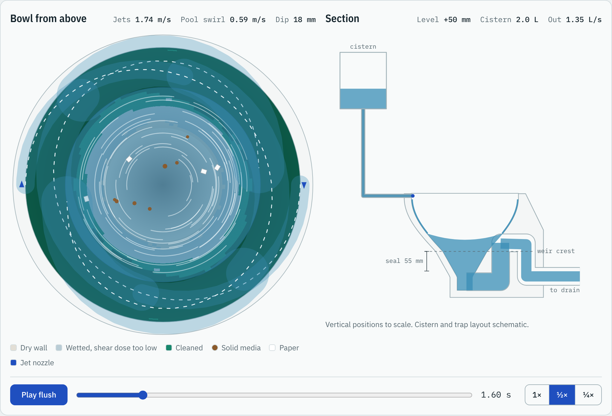
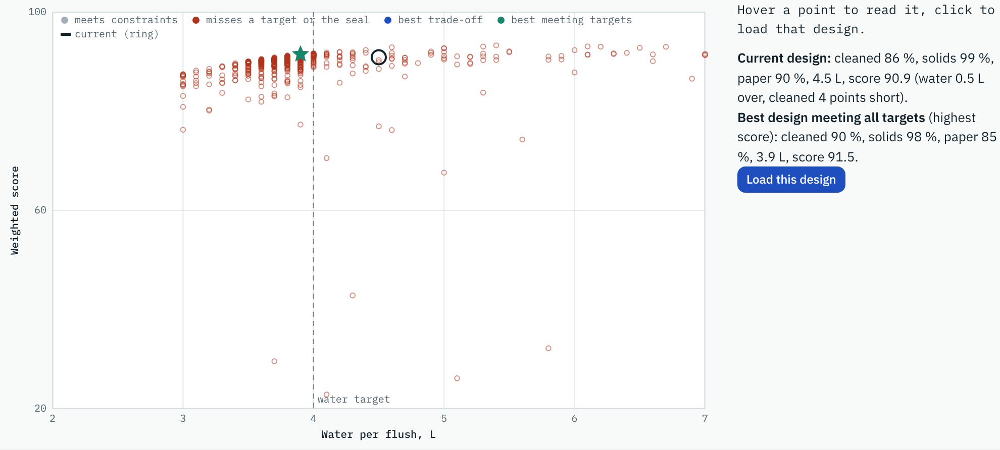

# Tangential Jet Flush Model

A fast model of how a rimless toilet flushes. Rim jets wash the bowl, swirl the pool and carry waste through the trap. Each flush computes in milliseconds in the browser, so you can change the design and see the effect on cleaning, waste removal, water use and relative noise right away. An AI lab searches for better designs and shows how the model would be trained and calibrated with high-fidelity simulation, such as PreonLab, Ansys Fluent, Simcenter STAR-CCM+ or OpenFOAM.

- **Live simulator:** https://fintlp.github.io/jet-flush-model/
- **Guided story, four parts:** [1 the fast model](https://fintlp.github.io/jet-flush-model/#demo) · [2 checked against CFD](https://fintlp.github.io/jet-flush-model/#cfd-tour) · [3 AI in the engineering loop](https://fintlp.github.io/jet-flush-model/#challenge-tour) · [4 what it means for your team](https://fintlp.github.io/jet-flush-model/#value-tour)
- **How the model works:** https://fintlp.github.io/jet-flush-model/method.html
- **Sources and references:** https://fintlp.github.io/jet-flush-model/sources.html
- **Why we built this:** https://fintlp.github.io/jet-flush-model/why.html
- **Slides:** [PowerPoint](slides/jet-flush-model.pptx) (with videos) · [PDF](slides/jet-flush-model.pdf)



> **Status.** The model is physics-based, but its coefficients are not yet calibrated against CFD or rig data. It has been compared with one OpenFOAM simulation of the washdown preset (a second simulation, not a measurement). Use the results to compare designs and decide what to check, not as validated values: neither the numbers nor the direction in which a design change moves them have been checked against real bowls yet.
>
> **Scope.** Splashing, jets hitting each other and spill-over are not modelled, so the model cannot say whether a design splashes; it only flags a pool that reaches the rim. The reference data in the AI lab and the engineering challenge are synthetic (the model with other coefficients and extra effects) and labelled as such; only the CFD check uses an independent simulation. The presets are generic EU washdown and siphonic bowls, not modelled on any manufacturer's product. Nothing here replaces CFD or tests.

## What it does

The simulator answers three questions for a given bowl and flush design, in this order:

1. **Cleaning:** how much of the bowl wall above the waterline gets enough wall shear from the jet films to count as cleaned.
2. **Waste removal:** how much of a solid test load and of floating paper leaves through the trap.
3. **Water use:** how much water the flush takes, and whether the water seal is restored.

A fourth result, **noise**, is an experimental, relative indicator in dB against a reference design: louder or quieter, and which part of the flush makes the noise (jet films entering the pool, water falling into the outlet, an air core reaching the trap, or the siphon break). Every noise result comes with a sampled range over five assumed coefficients, and a direction is only shown when the whole sampled range agrees. It is not a sound level, it is not yet checked against recordings, and it leaves out the cistern, valves, pipes and building. See [section 10 of the model description](https://fintlp.github.io/jet-flush-model/method.html#noise).

It splits the flush into simple physical sub-models: cistern, rim jets, wall film on an oval bowl, pool level and swirl, washdown or siphonic trap, and waste transport. One flush takes about 20 to 40 ms in a browser on a laptop; a free-surface CFD case of a flush runs for minutes to hours (about 2 hours on 12 cores for the OpenFOAM run used on the page).

## Quick start

1. Open the [live simulator](https://fintlp.github.io/jet-flush-model/) and press **Demo me** to start the guided story. Part 1 shows the fast model, part 2 checks it against CFD, part 3 shows AI in the engineering loop, part 4 what it means for a team, with a savings calculator; each part can be started on its own.
2. Pick a preset (EU washdown 4.5/3 L, or siphonic 4.8 L plus 0.8 L bowl refill) and change the bowl and jets with the sliders. Each slider has an **i** button that explains it.
3. Press **Play flush** and read the result cards. Green and red chips show how much each change helped or hurt.
4. Use **Undo**, **Reset** and **Pin as reference** to compare designs.
5. In the **AI lab**, let the optimiser find better settings, or give it targets such as "at most 4.0 L and at least 88 % cleaned".

On a phone, the sliders open from the **Adjust design** button at the bottom.

## Page tools

| Tool | What it shows |
|---|---|
| Bowl from above | Jet films, cleaned wall areas, pool swirl and waste media during the flush |
| Section | Cistern, bowl level, weir and trap, with vertical positions to scale |
| Result cards | Cleaning, waste removal, water use and relative noise, with changes against the previous design or a pinned reference |
| Flush traces | Flow in and out, bowl level, pool swirl, load left and noise level over time, with air core and siphon events; click to jump to a moment |
| Wall cleaning map | The bowl wall unrolled, showing dry, wetted and cleaned areas |
| Design sweep | A 12 × 12 heat map of one result over two settings; click a cell to load that design |
| Tolerance study | The spread of every result when the design deviates within production and installation tolerances, and which tolerances cause most of it |
| Checked against CFD | The fast model next to an OpenFOAM simulation of the same bowl: when the wall gets wet and what gets cleaned, side by side, with computing times and where they differ |
| Engineering challenge | How many expensive high-fidelity runs three routes need to reach the targets: one change at a time, the fast model alone, and the fast model with a learned correction; plus a hands-on mode |
| What it saves | A savings calculator: enter working days and person hours per iteration, the cost per hour and the design questions a year, and see the working days and money saved per design question and per year, and the break-even budget for a fast model; example values with their sources. Also on the why page |
| AI lab | Design optimiser, neural surrogate, hybrid calibration, noise calibration, a physics-informed network and a field surrogate, all running in the browser |

## AI lab

- **Design optimiser:** an evolutionary multi-objective search (NSGA-II style). You choose which jet, flush and bowl geometry settings may change, then either trade a weighted score against water or set targets it must meet, including an optional noise limit such as "no louder than now". An optional robust mode rates each design at the low end of its spread under the tolerances of the tolerance study. About 540 designs take about 10 seconds plus a few seconds for the check, with a progress bar, and every recommendation and table row it reports is re-checked at the simulator's own resolution; the other points in its chart are quick estimates.
- **Neural surrogate:** a small neural network trained in the browser on a few hundred flushes. It answers a few thousand times faster than the physics model (about 4,500 to 5,000 times in the test browser; the page measures it). This stands in for training a network on high-fidelity runs.
- **Hybrid calibration:** the calibration workflow end to end. Six coefficients are fitted with Nelder-Mead to a few reference runs, a Gaussian process corrects what is left, and all versions are checked on hold-out designs. The reference data is synthetic and labelled as such.
- **Noise calibration:** fits the noise coefficients to recordings of real flushes: audio files or sound level meter readings for a few designs, plus air core times from video. Audio is A-weighted and analysed in the browser, never uploaded. A demo with synthetic recordings from a hidden reference shows the workflow and checks the fit on designs left out.
- **Physics-informed network:** a small neural network that learns from a pool level record and from the model's pool balance at once, and finds the weir coefficient and the time water spends on the wall. The record is simulated (the full model with a hidden weir coefficient, read like a phone video). It is compared with the same network without physics and with a classic least-squares fit, and the page says plainly that least squares is the better tool for an equation this small.
- **Field surrogate:** predicts the whole cleaning map from the design settings (proper orthogonal decomposition plus Gaussian processes), trained on 10 to 80 expensive runs of a synthetic reference, and compared with the fast model alone and with the fast model plus a learned map correction. The honest result: even 80 runs (27 virtual days) leave the data surrogate well behind the fast physics model, partly because the reference maps come from the same equations as the fast model, which the page says.



Details are in [section 14 of the model description](https://fintlp.github.io/jet-flush-model/method.html#ailab).

## Run it locally

The page is static HTML and JavaScript with no build step and no dependencies. The fonts (Ubuntu and Ubuntu Mono) are in `fonts/`, so the pages make no requests to other hosts.

```bash
git clone https://github.com/fintlp/jet-flush-model.git
cd jet-flush-model
python3 -m http.server 8000
# open http://localhost:8000
```

The model also runs on its own in Node.js:

```js
require('./model.js');
const M = globalThis.FlushModel;
const p = M.defaults('washdown');      // or 'siphonic'
p.ovality = 1.3; p.jetPhase = 90;
const r = M.simulate(p, { light: true });
console.log(r.cleanPct, r.solidsPct, r.paperPct, r.water);
```

`simulate(p, opts)` takes the same parameters as the sliders. Options: `light` skips the time traces, `coarse` uses the looser wall film retrace tolerance of the sweep and the optimiser search, `filmTol` sets that tolerance (0 retraces at every time step, the reference for the checks), `Tend` sets the simulated time in seconds (default 12; the run goes on until the flush has settled, at most `Tmax`, default 60).

The checks run in Node too, for example `node checks/physics.js` and `node checks/regression.js`; `checks/README.md` lists them all with what they test and how long they take.

## Files

| File | Contents |
|---|---|
| `index.html` | The simulator page |
| `model.js` | The physics model: geometry, cistern, wall film, pool, trap, waste |
| `app.js` | Drawing, controls, sweep, undo and change tracking; no physics |
| `ai.js` | AI lab: optimiser, neural network, Nelder-Mead, Gaussian process |
| `tolerance.js` | Tolerance study panel |
| `cfdcheck.js` | Checked against CFD panel: reads the OpenFOAM run files and media from `cfd/washdown/`, computes the model for the same flush |
| `challenge-core.js` | Engineering challenge: synthetic reference, the three routes, races (no page code, also runs in Node) |
| `challenge-data.js` | The eight stored races, written by `node checks/challenge.js --write` |
| `challenge-worker.js` | Web worker that recomputes a race live |
| `challenge.js` | Engineering challenge panel: charts, race table, Your turn |
| `pinn-core.js`, `pinn.js` | Physics-informed network: training (no page code) and its AI lab tab |
| `field-core.js`, `field.js` | Field surrogate: POD and Gaussian processes (no page code) and its AI lab tab |
| `tour.js` | The guided story in four parts: Demo me, the CFD check tour, the challenge tour, and what it means for your team |
| `value-core.js`, `value.js` | What it saves: the why page figures and the savings calculator computed from the stored races (no page code, also used by `checks/value.js` and `tools/slides.js`), and the calculator form on the simulator and why pages |
| `reviews/` | The independent reviews and what was done about each finding |
| `fonts/` | Ubuntu and Ubuntu Mono (Latin, Latin Extended and Greek), self-hosted, with their licence |
| `checks/` | Deterministic scripts: physics checks, regression against the stored 2.0 baseline (`baseline-2.0.json`) or another model version, page checks in a headless browser, film update resolution, noise range, plausibility against published figures, and checks of the challenge, the PINN and the field surrogate. See `checks/README.md` |
| `cfd/` | OpenFOAM reference (owned by the CFD work): case generator, job runner, post-processing, run summaries in `cfd/washdown/runs/`, media in `cfd/washdown/media/` |
| `method.html` | Full model description: equations, numerics, coefficients, calibration |
| `sources.html` | Sources and references |
| `why.html` | Why we built this: faster loops from idea to engineering to manufacturing |
| `media/` | Video of a flush (`flush-playback.mp4`), the whole guided story recorded at reading pace (`demo-walkthrough.mp4`) and stills of each view, the CFD maps, the challenge, the savings calculator and every AI lab tool, made by `tools/media.js`; `qr-live.png`, the link to the live page for the slides |
| `slides/jet-flush-model.pptx`, `.pdf` | Eleven slides that work without a presenter: each title states its message, every slide has speaker notes with the full story, and the two videos are embedded (the PDF shows their posters). Each slide carries the author, the repository link, the version and the date. `slides/figures.json` holds the page figures the slides quote, read from the live page by `tools/media.js`; the challenge and savings figures come from `value-core.js` |
| `tools/` | `media.js` regenerates the stills, the videos and `slides/figures.json` from the page; `slides.js` builds the deck from them (needs `pptxgenjs`). Commands in the file headers |

## Calibration

The coefficients that describe physics the model does not resolve (film friction, spreading, soil shear threshold, swirl transfer, transport thresholds and others) are fitted to a few reference runs. The procedure, the order of fitting and which measurement or CFD output to use for each coefficient are in [section 13 of the model description](https://fintlp.github.io/jet-flush-model/method.html#calibration). The reference runs can come from any high-fidelity free-surface solver: particle-based (SPH) such as PreonLab, nanoFluidX or the SPH solver of Simcenter STAR-CCM+, or mesh-based (VOF) such as Ansys Fluent or CFX, Simcenter STAR-CCM+, OpenFOAM or FLOW-3D. Section 13 compares them for this job. A good start is one preset in one tool of each family, checked against a simple rig measurement; paper removal is best calibrated against physical tests.

## Change log

### 2.1.0 · in preparation

Version 2.1 explains to managers what a faster design loop is worth and how each figure is calculated. The model and its results are unchanged from 2.0.0.

**Simulator page: the why first**

- **The heading carries the message:** "Faster design loops, shown on a toilet flush", with the model's name above it. The intro says in three sentences why: engineering waits for answers, and a fast physics model with AI on top spends the slow tools only where they decide. The technical description is shorter.
- **"Why this matters" card** at the top: 6 fewer expensive iterations per design question (10.5 → 4.5, about 6 working days, synthetic reference), with "Why we do this →" (the why page) and "What it saves your team". Before, the why page was the second of five small links at the end of the intro.

**Why page: every figure traceable**

- **Per design question first.** The headline is the typical project of the engineering challenge: 10.5 expensive iterations with the classic route, 4.5 with the AI route, **6 fewer**, about 6 working days at a day each. Before, the page led with the total over the eight races as "≈ 2.5 months", which read like a portfolio of eight products (they are eight starts of one task) and rounded 54 working days, 2.57 months, down.
- **"How this is calculated"** under each figure: the sorted iteration counts and their medians, the subtraction, the day per iteration and its source; all eight races in a table with the totals (97 − 43 = 54 iterations, 54 working days, about 2.6 months); why the fast model alone gets stuck.
- **The spread is shown:** the AI route needed fewer iterations in 6 of 8 races, the same in one, and 4 more in one. Race by race the saving ranged from −4 to 24 (median 5.5, average 6.75); the headline of 6, the difference between the typical projects, sits between the two.
- **Two clocks in one box:** 8 hours of computing per run in the challenge, about one working day per iteration on the why page.
- **Fixed:** the "3 of 8" figure was never updated from the data, because its line of code sat inside a comment (it was correct by chance); `checks/value.js` now guards against this.
- **The toilet is the example, not the limit:** a table that reads "fast model", "expensive run" and "one iteration" for five other product areas.
- **Call to action:** try the demo, open the simulator, contact Peter Fintl and ask for a workshop.

**Savings calculator (why page and simulator page, What it saves)**

- The reader enters working days per iteration, person hours per iteration, the cost per hour, computing and licence cost per run, design questions a year and, optionally, the effort to build and calibrate a fast model. Results per design question and per year, each with its calculation in small print: working days, money, and the **break-even budget**: a fast model pays for itself within a year if building and calibrating it costs less than the yearly saving. With a build effort, the payback time.
- **Example values on a button, each with its source:** 1 working day per iteration (Geberit, CADFEM Journal), 8 person hours (one engineer for that day), 95 € per hour (average rate of freelance engineers in Germany, freelancermap, February 2026), 10 design questions a year (an example only). No example for computing and licence costs or for the build effort, since there is no measured figure. With the examples: 4,560 € per design question, 45,600 € a year.
- Nothing entered is stored or sent anywhere. Time to market is not priced in, and the page says so.

**Guided story, part 4: what it means for your team**

- Seven steps for managers on the simulator page (Guided tour in What it saves, the end of part 3, or `#value-tour`): where the time goes, the typical project, not every race is a win, two clocks, the calculator with the example values, the break-even budget, and how a team would start, with the call to action. The calculator is left as it was before the tour.
- Part 3 now ends with the saving per design question and offers part 4.

**Slides**

- **Eleven slides that work without a presenter,** in place of six: the problem (design loops wait for expensive answers), the approach (fast physics explores, AI narrows, high fidelity decides), three proofs (the fast model, the check against CFD, AI in the loop with a native chart of all eight races), what it is worth (the calculation step by step with the example values and the break-even budget), the toilet as an example for other products, what the demo shows and does not show yet, how a team would start, and the next step: try the page (with a QR code), watch the story, contact Peter Fintl for a workshop.
- **Every title states the message**, not the topic, and **every slide has speaker notes** with the full story.
- The challenge and savings figures come from `value-core.js`, the code the pages use.

**Media:** the story video covers all four parts; a still of the calculator (`media/value.png`).

**Checks:** new `checks/value.js` (17 checks, about a second): the arithmetic of every step, the example values and their sources, the figures written into why.html against the data, and the figures the slides use. `checks/browser.js` now has 92 checks, adding the why page figures and calculation boxes, the calculator (empty start, examples, run cost, payback, Clear), the What it saves panel and part 4 of the story. All pass; regression 0 differences (the model is unchanged), challenge --quick 10 of 10.


### 2.0.0 · 21 October 2026

Version 2.0 changes model results. Many of the changes come from independent reviews: a physics review of the development branch and three external reviews of the release candidate; [reviews/](reviews/) has the findings and what was done about each.

**Wall film**

- **Film enters the pool where its lower edge meets the waterline.** Each jet is still one spreading band, but the share of its width below the waterline now enters the pool there, with its flow, swirl and splash; the band left on the wall is re-centred on what remains. Before, the whole film entered where its centreline reached the waterline, so a tiny change in jet speed or pool level could switch the film between entering on its first dip and circling once more, and the pool swirl jumped (in the washdown preset by about 15 % at 2.7 s). Flow that stalls on the wall or is still there after 3 m of path counts as lost and brings no swirl or splash (`filmLostPct`).
- **Film tracer integrates correctly.** The speed comes from the energy balance over each step (gravity work minus friction work), the position uses the mean of old and new velocity, and the velocity is turned into the new tangent plane instead of being cut and rescaled. Without friction a film now keeps its energy and its angular momentum about the bowl axis; in 1.3 it lost up to about a fifth of its kinetic energy over 3 m and was steered downwards. A film that climbs back to the rim loses its upward speed at the rim lip.
- **Film takes time to reach the pool.** Water on the wall is a store that tends to nozzle flow times the films' mean travel time; nothing arrives before the film front, and the wetted area grows with the front when the flush starts. In the washdown preset about 1 L is on the wall during the flush and the first water reaches the pool after about 0.5 s. Before, all jet flow reached the pool in the step it left the nozzle.
- **Film traced when the flow changes, not on a fixed clock**, when jet speed or pool level has changed by more than 3 % or 3 mm, and at least every 0.25 s (10 %, 10 mm, 0.6 s in the sweep and the optimiser search). The shear dose of each interval is the mean of the footprints at its start and end. Against retracing at every step, cleaning differs by 0.7 points at the 95th percentile (1.3: 1.8 points at 100 ms); the worst known case, a short strong flush, gives 51.2 % against 49.9 % (1.3: 43 % against 35 %) (`checks/resolution.js`). Over 60 random designs a flush takes about 1.6 times as long as in 1.3.1 (median about 30 ms on the check machine), a sweep or search flush about 1.3 to 1.4 times.
- **Cleaning map counts cells by their centres.** A wall cell counts as covered when its centre lies inside the rectangle a film step sweeps, worked out in wall coordinates. Cleaning now converges as the grid is refined: on the 90 × 40 grid it is within about 0.2 points (median) and 0.9 points (worst) of a grid four times finer with a 1 mm film step. The old any-touch counting overstated cleaning by about 2 points on average and up to about 5.
- **Rim line measured at exactly 25 mm depth**, weighted by length round the bowl on oval bowls. Before, the row was chosen 25 mm along the wall.
- Nozzle width above the rim is folded onto the wall, so a wide nozzle loses no flow above the rim.

**Cistern, pool and siphon**

- **Partial flush from a full cistern.** A partial flush now releases its volume from a full cistern, as a dual-flush valve does, so its head and jet speed start at the full-flush values (siphonic partial flush: 70.5 to 85.1 % cleaned).
- **Siphon break.** The pool level stops exactly at the trap inlet when the siphon breaks (before, it overshot by up to 29 mm and a floor clamp could create water); the draw-down is sub-stepped, so level, break time and spin-up do not depend on the time step. The siphon may prime again, and the break gurgle only sounds while it is broken.
- **Refill simulated.** The bowl refill runs in at 0.1 L/s once the valve has closed, so the pool level trace ends at the reported seal.
- **Pool inertia integrated over the narrowing basin.** It was 1.6 to 1.8 times too high, so swirl came out too low and the vortex dip too small. Peak swirl and dip are reported while the trap carries flow.
- **Siphonic preset refill raised from 0.6 to 0.8 L**, so the simulated refill restores the seal after a partial flush too (0.6 L left it at 48 mm, below the 50 mm flag). The preset now uses 5.6 L per full flush including the refill.
- The last, capped step of a flush no longer triggers a film trace with its arbitrary small flow; that trace had set how fast the wall water drained and made siphonic results depend on the time step.

**Noise**

- **Noise calibration tab in the AI lab.** Fits the five noise coefficients to recordings of real flushes: audio files (A-weighted per IEC 61672-1 and turned into a fast 125 ms level in the browser) or sound level meter readings, for a few designs set up in the simulator, plus optional air core times from video. Only the differences between designs count, so microphone, room and distance cancel. A leave-one-design-out test says whether the fit carries over. The demo makes synthetic recordings from a hidden reference with a valve click, fill valve noise, scatter and a low-pitched gurgle the model does not know; the fit lowers the error on left-out designs from about 0.6 to about 0.2 dB. Recordings stay in the browser; only peak levels are remembered.
- **Noise computed from recorded flow series.** The simulation now records the flow quantities the four noise sources need, and a separate `noiseEval` turns them into the noise result. The results are bit-identical to before; the calibration can evaluate any coefficients in well under a millisecond without simulating again.
- Model description: the plunging-jet entrainment law is stated as an extrapolation to wall films; the wetted pool area and Ramanujan's perimeter are written out.

**One guided story and the CFD check**

- **The loop told with a clock (why page):** "One design loop, two clocks" shows the median project of the engineering challenge as a timeline at one working day per iteration (Geberit's figure, stated as an assumption): 10.5 days classic against 4.5 days AI-assisted; 97 against 43 iterations over eight synthetic projects, about two and a half months of assumed working days saved. The numbers are computed from the stored races. Part 3 of the story ends with them. The why page also lists the new methods and its limits.

- **Field surrogate** (AI lab, sixth tab): predicts the whole cleaning map from 10 to 80 expensive runs. With 80 runs it matches 84 % of the cleaned area of unseen designs and misses the cleaned share by about 10 points; the fast model alone, with no expensive runs, 95 % and 1.7 points; with a learned map correction 95 % and 1.6. The page explains why and when field surrogates pay off (`field-core.js`, `checks/field.js`).
- **Physics-informed network** (AI lab, fifth tab, and step 5 of story part 2): from 81 or 13 noisy level readings of a flush simulated with a weir coefficient of 1.45 (the model uses 1.7), it finds 1.42 to 1.44 and estimates the unmeasured water on the wall; least squares finds 1.49 to 1.50 in tens of milliseconds. A record that stops after 3 s cannot identify the coefficient, and the page shows that too. Own forward and backward pass with time derivatives, no library (`pinn-core.js`, `checks/pinn.js`).

- **New panel "Checked against CFD".** The fast model next to an OpenFOAM simulation of the same bowl and jets, on the same unrolled wall: when each part gets wet (time slider and playback) and what gets cleaned, the CFD's wall-clock time against the fast model's milliseconds, and where the two differ (first water in the pool, film paths, the band near the waterline, pool swirl). The CFD runs come from the `cfd/` work; the page uses the whole 3.2 s flush on the medium mesh (2 mm cells at the wall, 428,584 cells, about 2 hours on 12 cores) and computes the model live for the same window. Over the flush the CFD wets 98 % of the wall and cleans 89 %, the fast model 96 % and 86 %, with different patterns, which the page says. **Two-mesh sensitivity:** the same set-up on the coarse mesh (3 mm cells, 157,596 cells, 23 minutes) gives 87 % cleaned and 98 % wetted, first water in the pool 0.15 s against 0.14 s, pool swirl at 1 s 0.82 against 0.70 m/s, and the same cleaned verdict on 92 % of the wall; the page shows this as a sensitivity, not as mesh independence. Every view says it is a second simulation, not a measurement. A video and stills of the CFD flush (rendered with VTK through PyVista) are shown below the maps.
- **The guided tours become one story in three parts:** 1 the fast model (Demo me), 2 checked against CFD (new, four steps), 3 AI in the engineering loop (the challenge tour). Each part can be started on its own (`#demo`, `#cfd-tour`, `#challenge-tour`) and ends by offering the next.
- **Demo me asks for 1 cleaning point more, not 2.** Under 2.0 physics no design within 4.0 L met +2 points (the best missed by 0.1), so the walkthrough ended at the closest design. With +1 it finds one that meets every target (washdown preset: 89 % cleaning, 4.0 L, 0.5 dB quieter).

**Engineering challenge**

- **New panel: how many expensive runs to reach the targets.** A synthetic reference stands in for CFD; each run costs a virtual 8 hours. From an oval washdown bowl at 4.5 L (74.5 % cleaning), three routes must reach 4.0 L, 87 % cleaning, 95 % solids and 80 % paper: an automated one-change-at-a-time search in a fixed, sensible order, the fast model alone, and the fast model with a correction learned after every run (ridge trend plus Gaussian process, next run where all targets are most likely met). Eight races (eight start designs and random choices) play at once on one virtual clock: how many projects each route has finished, the best cleaning in a chosen race, and what the AI route expected before each run. AI route median 4.5 runs (2 to 13), classic 10.5 (2 to 26), fast model alone missed within 60 runs in 3 of 8; 43 runs in total against 97. A hold-out set of eight more races, never shown and not used for tuning, gives AI 4 and classic 10.5 (`node checks/challenge.js --holdout`). The races are stored in `challenge-data.js`; any race can be recomputed live in a web worker, and the page says whether it is identical. A nine-step guided tour (button, end of Demo me, or `#challenge-tour`) walks an audience through it. "Your turn" lets visitors use the simulator as their fast model and spend reference runs by hand. The page states that the reference is synthetic and lists how it differs.

**Tolerances**

- **Tolerance study panel.** Varies the current design within tolerances for 13 settings (nozzles and jets, bowl shape, valve height, supply path loss and flush volume), simulates 40, 100 or 200 copies at full resolution (100 take a few seconds) and shows, for each result, the nominal value, the 10 % and 90 % points, the median and the range, plus which tolerances explain most of the spread (linear fit, with its R²). Deviations are normal with the tolerance as two standard deviations, cut off at the tolerance, drawn by Latin hypercube with a fixed seed. The default tolerances are assumptions and can be edited. For the washdown preset, cleaning spreads by under one point, about as much as the model's own resolution error, which the panel says.
- **Robust optimiser search.** An option in the design optimiser rates each design at the low end of its spread under these tolerances: six varied copies per design in mirrored pairs, the same for every design, with cleaning, solids and paper at mean minus 1.28 standard deviations and water and noise at mean plus 1.28. A design must restore the seal in all copies. About seven times slower than a normal search.
- **Optimiser fairness (review finding F-08):** during the search, quick estimates are compared with the current design's quick estimate (this matters for a noise limit against the current design); designs that miss the targets only by about the quick estimate's error are checked at full resolution too (at most 24 per check); the check limit is now 200 designs, and in the cases tried no check reaches it.
- **Progress bar for the optimiser**, also in the Demo me card and the tolerance study. It shows the step (searching or checking at full resolution), the generation, the designs so far and the time left; for the check, whose length is not known in advance, a range up to the limit of 200 designs. Cancel search stops a search with no result; Stop check reports only the designs checked so far.

**External review of the release candidate (commit 37dc418)**

Three independent reviews of the same commit (ChatGPT, Grok Bot, Grok web); every finding was checked against the code and data, and the full list with verdicts is in [reviews/release-candidate-2.0.md](reviews/release-candidate-2.0.md). The main fixes:

- **R-01, noise from the jet films:** the model averaged the velocities and entry points of all entering film parts before applying the nonlinear entrainment law, so two opposite jets cancelled most of the speed and the film source was nearly always zero. Now every entering part counts at its own speed relative to the pool. Peak noise changes by 0.6 dB in the median and up to 3.7 dB over 100 random designs; the washdown preset now gets 5 % of its peak from the films. New physics checks D10a and D10b.
- **R-02 and R-03, field surrogate:** reference maps were divided by the fast model's cleaning dose (1.5 instead of the reference's 1.6 Pa s) and weighted with round-bowl areas on the oval bowl. Now each map uses its own run's dose and the simulator's cell areas; a new check confirms that every map's cleaned share equals the simulator's cleaning. With 80 runs the data surrogate now matches 84 % (was 85 %).
- **R-04, trends:** the page no longer says the fast model is "right on the trends": one CFD design on two meshes cannot show that. It says the totals are close for this design and that design trends still need CFD runs of several designs.
- **R-05 and R-06, slides:** the challenge figures are labelled synthetic on every slide, the saving is given as assumed working days, and the optimiser line says which designs are checked at full resolution.
- **R-07, classic route:** it is now called an automated one-change-at-a-time search and uses the same sensible order in all eight races (before, races 2 to 8 used a random order). Classic median 12 to 10.5, total 110 to 97; AI unchanged at 4.5 and 43. The hold-out races are now reproducible with `--holdout`.
- **R-08:** the warning colour is darker (5.7:1 on white instead of 4.4:1), so every text colour meets 4.5:1.
- **R-09:** the "How the model works" section lists all six AI lab tools and no longer says there is no physics-informed network.
- **R-10:** every page declares its icon, so browsers no longer request a missing `/favicon.ico`.
- **CFD maps (Grok):** cell by cell, CFD and fast model agree on cleaned or not at about chance level; the panel and the slides now show the overlap of the uncleaned areas (11 % CFD against model, 50 % between the two meshes) instead of the 92 % agreement, and the CFD caveat describes the jet inlet patch (about three times the nozzle area).
- **Reference gap (Grok):** the synthetic reference cleans about 6 points less than the fast model (spread about 5), not 3 (spread 2); corrected and pinned by a check.
- **Field surrogate (Grok):** the page says that its reference maps come from the same equations as the fast model, which gives the fast model a head start.
- **Smaller fixes (Grok):** both time bases of the challenge explained, consistent timings, the limits of the optimiser's full-resolution check, the calibration demos as an easy case, noise calibration shown with synthetic recordings only, the orifice coefficient documented, tap targets of 24 px on touch screens, font copyright, and the review history in `reviews/`.

**Slides, video and stills**

- **New slides, six instead of three,** following the three-part story: the fast model, the CFD check, AI in the engineering loop, then the two clocks and the whole story. Same look as the page. Every number on them comes from `slides/figures.json`, which `tools/media.js` reads from the live page.
- **New walkthrough video** of the whole guided story, all 23 steps at reading pace (about 4 minutes), and a new flush playback video, drawn frame by frame from the page.
- **Stills** of every view in the new look, plus the CFD maps, the challenge chart, the physics-informed network and the field surrogate.
- **Reproducible:** `tools/media.js` and `tools/slides.js` rebuild all of it; before, the slides and videos were made by hand.

**Look and feel**

- **Capgemini-inspired look.** Ubuntu for text and Ubuntu Mono for numbers, Capgemini's blues (#0070AD for links, buttons and highlights in light mode, #12ABDB in dark mode), navy text, a thin blue gradient across the top of every page and rounded buttons. No logo; the byline stays Peter Fintl. All text colours meet the 4.5:1 contrast rule in both modes.
- **Fonts served with the page.** Before, the pages loaded IBM Plex from Google Fonts, which sends each visitor's IP address to Google. Now the fonts are in `fonts/` and the pages make no requests to other hosts.
- Charts follow: their text is set in Ubuntu Mono, 15 % larger to stay as readable as before. Three charts that drew two series in similar blues now use navy for one of them (flow into the bowl, training designs in the surrogate, the calibrated model in the hybrid calibration). The flush trace titles and the rim line label in the wall map get a light backing, so curves no longer run through them, and the 360° label in the wall map is no longer clipped.

**Accessibility and phones (review finding F-18)**

- The AI lab tabs follow the tab pattern: arrow keys, Home and End move between the six tools, and the tab row is one stop for the Tab key.
- All 27 charts are announced as images with their description.
- In the guided story, the card's text is read with it, the keyboard focus stays in the card while a step works, and arrow keys on a slider, field or tab row no longer turn the page of the story.
- On phones the race table of the engineering challenge shows one route per block, and chart placeholders shorten when they do not fit.

**Calibration**

- **Not only PreonLab.** Section 13 of the model description now covers high-fidelity free-surface simulation in general: the two families (mesh-based VOF and level set, particle-based SPH), what each does well and badly for thin wall films and wall shear, and eight candidate tools (PreonLab, Ansys Fluent and CFX, Simcenter STAR-CCM+, nanoFluidX, COMSOL, OpenFOAM, FLOW-3D, DualSPHysics). It suggests starting with one preset in one tool of each family against a simple rig check, since two solvers can differ markedly on the same bowl. Texts on the page, the README and the AI lab no longer name PreonLab as the only reference.

**Checks**

- **New `checks/physics.js`, 59 checks with pass limits:** conservation and balance (energy and angular momentum of a frictionless film, water balance, physical ranges, smoothness of swirl and main results with refinement that tells jumps, steep slopes and time-step jitter apart); closed-form cases (cistern drain, steady weir level, level table, film on a vertical cylinder, paper decay); Runge-Kutta re-integration of pool level and swirl; and the checks proposed by the review (spatial convergence, siphon break, time step down to 1 ms, partial flush head, film front, monotone waste trends, round-bowl symmetry, rim line depth). `--strict` makes known open issues fail. All 59 pass, also with `--strict`.
- **New `checks/literature.js`: the presets against published figures** from toilet CFD studies, patents and an independent flush test. Peak flow into the bowl (1.6 to 1.7 L/s), mean flow while released (1.4 to 1.6 L/s) and trap diameter lie inside the published ranges. Film turns on the wall (1.9 to 2.5 against about 3) and the water held in the bowl per litre flushed (0.53 to 0.56 against 0.52 for a vortex bowl) agree. Three differences are reported, not hidden: the presets hold too little water at rest (known), outflow starts earlier than in a published vortex bowl, and waste removal falls steadily with trap diameter where a published siphon study finds an optimum at 50 to 53 mm, because priming in the model does not depend on trap size. Wall shear under the film is about three times the one published figure, which is not directly comparable. A plausibility check, not a validation; method section 13 has the table.
- **`checks/regression.js` has a stored 2.0 baseline** (`checks/baseline-2.0.json`, 200 random designs, all main results plus noise), so it runs on its own; `--write` renews it after a deliberate change. Compared with another `model.js`, only the randomly drawn settings are passed on, so each version uses its own defaults; before, a changed default coefficient went unnoticed.
- **`checks/timing.js` also times 60 random designs**, at full resolution and in the coarse mode, and reports medians, 10 and 90 % points and the ratio against another version; the run time figures in section 11 come from it.
- **New `checks/challenge.js`** for the engineering challenge: recomputes the eight races and compares them with `challenge-data.js` (`--write` regenerates the file).
- **New `checks/pinn.js`** (6 checks, about 5 s) for the physics-informed network.
- **New `checks/field.js`** (5 checks, about 15 s) for the field surrogate.
- **`checks/browser.js` now has 82 checks**, adding the noise calibration (A-weighting of test tones, demo fit, WAV file, meter readings), the tolerance study (spread, one tolerance alone, all zero, reset, out-of-date note, progress bar), the robust search, the optimiser's progress bar, Cancel and Stop, also in the demo, and the engineering challenge with its live recomputation and guided tour, the CFD check and the three-part story, that Demo me's search meets every target, the accessibility of tabs, charts and story, and that all four pages load their fonts from the page itself and nothing from other hosts. All pass.

**Effect on results**, 300 random designs against 1.3.1: cleaning +1.9 points in the median (5 % lose more than 4.8 points, 5 % gain more than 20, mostly short, strong flushes); peak pool swirl +28 % in the median and the vortex dip about 12 mm deeper, mainly from the corrected pool inertia; solids and paper change little in most designs. Presets:

| Preset | Cleaned | Solids | Paper | Peak swirl | Vortex dip | Seal |
|---|---|---|---|---|---|---|
| Washdown, full | 87.6 → 86.5 % | 99.4 → 99.2 % | 90.0 → 89.9 % | 0.64 → 0.84 m/s | 21 → 36 mm | 55 mm |
| Washdown, partial | 87.5 → 86.5 % | 93.3 → 93.4 % | 71.4 → 73.0 % | 0.57 → 0.84 m/s | 16 → 36 mm | 55 mm |
| Siphonic, full | 96.1 → 89.9 % | 98.9 → 98.7 % | 87.3 → 89.5 % | 0.77 → 1.09 m/s | 30 → 60 mm | 54 → 60 mm |
| Siphonic, partial | 70.5 → 85.1 % | 93.5 → 95.0 % | 69.2 → 78.7 % | 0.65 → 0.84 m/s | 22 → 36 mm | 55 → 59 mm |

**Documentation:** README files table and the method page's code map cover all 2.0 files; run times, optimiser time and the neural surrogate's speed-up re-measured for 2.0; limits updated for the synthetic references and the CFD check; a note on keyboard and screen reader use; three references added (OpenFOAM, the k-omega SST model, the method of snapshots).

Model description: corrected angular momentum statement; new subsections on integration, film entry and transit; partial flush, siphon break, refill, pool inertia, cleaning map, numerics and resolution notes; noise figures for the presets updated; published bowl data (water surface, volume at rest, seal) compared with the presets; new limits.

### 1.3.1 · 20 October 2026

Patch release with fixes from an independent review of 1.3.0. Model results are unchanged.

- The preset menu always matches the trap type, also after Undo, the demo or the trap type buttons, so Reset returns to the right preset. Switching a washdown design to siphonic sets a bowl refill when none was set, so the seal is restored.
- The pool radius now always stays at least 25 mm smaller than the rim radius, as in the AI lab: the slider being moved stops at that gap, and design sweep cells that break it are hatched and not simulated. Before, an equal rim and pool radius made the bowl wall vanish from the top view.
- Demo me leaves no undo steps or changed comparison chips behind. Keep this design adds one undo step back to your own design. A demo closed and reopened during the AI search no longer shows the old search message.
- Loading a sweep cell, Reset or an AI result right after moving a slider keeps the slider change as its own undo step.
- The pinned reference is recomputed with the current model and noise coefficients, so changing a coefficient no longer shows a change for an unchanged design.
- AI lab: the optimiser checks a noise limit against the current design too (it reads 0 dB against itself), and refuses to start from a design that breaks the rim gap when neither radius is searched. The surrogate readout says it is for a full flush and notes when the simulator is set to a partial flush; the partial flush volume no longer marks the surrogate or the calibration as out of date.
- Links from the simulator page to the other pages and the slides are relative, so a local or branch copy opens its own pages. The siphonic preset is labelled 4.8 L + 0.6 L refill, matching the 5.4 L water use it reports. Page descriptions mention relative noise.
- Slides, walkthrough video and stills are unchanged from 1.3.0 and still carry that version; the results they show, including the Demo me result of 87 % cleaning at 4.0 L, are the same in 1.3.1.

### 1.3.0 · 20 October 2026

- Noise indicator, experimental: a fourth result card with the peak noise in dB against the preset, or against the pinned reference when one is set, its range over five assumed coefficients, sound energy, which source makes the peak and which makes most of the energy, when an air core reaches the trap and the siphon break gurgle.
- Four sources, each written as a flow of air into the water: jet films entering the swirling pool, water falling into the outlet, an air core at the trap (Rankine vortex with the pool's angular momentum) and the siphon break.
- Noise trace with uncertainty band and air core shading, noise in the design sweep, and a noise limit (upper end of the range) and "quietest" pick in the optimiser. The Demo me walkthrough reports noise and asks for "no louder than now".
- Fixes from four external reviews, including two in 1.2.0: the optimiser's finished recommendations come only from designs checked at full resolution, also after targets or weights change (results being re-checked are greyed out meanwhile); while a search runs, its table shows quick estimates, labelled as such; a new search cancels any running search or check; each result can only be loaded with the settings of the search it came from. A sweep is marked out of date when settings change while it runs. Pinning updates the noise trace too, and the demo sets a pinned reference aside and runs its own search.
- `checks/` folder with deterministic scripts behind the quoted check figures: regression against another model version, film update resolution, time step, preset figures, noise range and run time.
- Model description: section 10 on noise, and a note on the resolution of the film updates. New sources on bubble acoustics, air entrainment and intake vortices.

### 1.2.0 · 20 October 2026

Includes all of 1.1.0, which was not published as a separate release.

- The Demo me walkthrough no longer leaves its oval demo bowl behind. **Finish** now brings your own design back; only **Keep this design** keeps the demo result. Nothing is remembered while the walkthrough runs, so closing the tab mid-demo is safe too.
- When the page opens with a remembered design that differs from its preset, a note says so and offers **Reset to preset**.

### 1.1.0 · 19 October 2026

Fixes from an external review, and clearer scope. Not published as a separate release; included in 1.2.0.

- Slow flushes now run to completion, up to 60 s, and the playback follows; a flush that does not finish is marked incomplete. Water use counts the water actually released.
- A pool that reaches the rim is detected as an overflow; spilled water is counted and the results are marked not valid.
- A water seal below 50 mm is now always flagged, also when the seal depth itself is set below 50 mm, as the documentation says.
- AI lab results notice when settings they did not vary have changed, say they are for the earlier configuration, and compare against the current settings. The optimiser never counts overflowing or unfinished designs as solutions; the sweep marks them with a red cross. The optimiser re-checks the designs it reports at the simulator's own resolution, so its numbers match the page.
- Every result card is labelled as an estimate. Scope statements on splashing, the kind of AI used and generic presets added to all pages. Calibration and speed claims softened to what is actually shown.

### 1.0.0 · 19 October 2026

First public release.

- Interactive simulator of a rimless WC flushed by tangential rim jets: oval bowl, jet films, pool swirl, washdown or siphonic trap, waste transport, design sweep.
- AI lab: design optimiser with free choice of variables and targets, neural surrogate trained in the browser, hybrid calibration demo.
- Usability: Start here strip, section menu, Undo, Reset, Pin as reference, change chips, help for every slider, phone drawer, and the Demo me walkthrough (`#demo` link).
- Documentation: model description, sources and references, "Why we built this" page, this README.
- Media and slides: flush video, recorded walkthrough, stills, three slides as PowerPoint and PDF.

### Development history, 19 October 2026

- **0.9** "Why we built this" page; slide links on all pages.
- **0.8** Full documentation: README, page tools, version history, new stills, walkthrough video, two more slides, author line on every slide.
- **0.7** Usability features and the Demo me walkthrough.
- **0.6** Optimiser: choose what may change, meet targets, thorough search.
- **0.5** AI lab with optimiser, neural surrogate and hybrid calibration; new intro.
- **0.4** Sources and references page.
- **0.3** Oval bowls and jet position; model description page.
- **0.2** Contact link.
- **0.1** First version: simulator, flush video, stills and slide.

## Name

"Tornado Flush" is a TOTO trademark. This project uses the neutral, descriptive name "tangential jet flush" and is not affiliated with any manufacturer.

## Licence

MIT, see [LICENSE](LICENSE). Copyright 2026 Peter Fintl. The fonts in `fonts/` (Ubuntu and Ubuntu Mono, via Fontsource) are under the Ubuntu Font Licence 1.0, copyright 2011 Canonical Ltd.; they are the unmodified subset files Fontsource distributes, see [fonts/LICENCE.txt](fonts/LICENCE.txt).

Contact: [fintlp.github.io](https://fintlp.github.io/latest-news/#contact)
